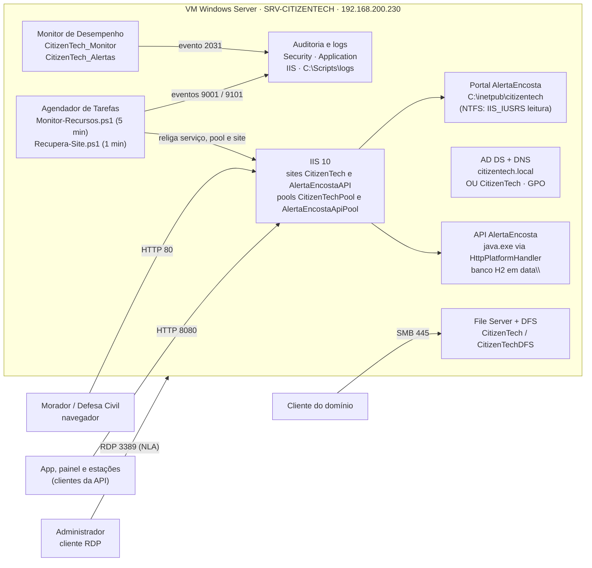

# AlertaEncosta · Infraestrutura Windows Server

**Disciplina:** Operating Systems · **Global Solution 2026.2 – CitizenTech** · FIAP Engenharia de Software, 3º ano

Infraestrutura Windows Server que hospeda, monitora e recupera automaticamente o portal web e a API REST (Java/Spring Boot) do **AlertaEncosta**, a CitizenTech da equipe: alertas de chuva forte e rotas seguras para quem mora em áreas de risco da Vila Brasilândia (SP).

| Integrante | RM |
|---|---|
| Gustavo Neri Santos | RM560239 |
| Matheus Aparecido Rocha Plati | RM559813 |
| Gustavo Pandolfo Meroni | RM560271 |
| Gabriel Machado Belardino | RM550121 |
| Gustavo Franco Tárano | RM559616 |


---

## 1. Ficha da CitizenTech

| Campo | Resposta |
|---|---|
| **Nome da CitizenTech** | AlertaEncosta |
| **Cidade e bairro** | São Paulo (SP) · Vila Brasilândia, zona norte, bairro com muitas moradias em encostas |
| **Cidadão beneficiado** | Morador de encosta ou área alagável; prioridade para idosos e pessoas com deficiência. Também atende o agente da Defesa Civil e o líder comunitário (NUPDEC) |
| **Problema, em uma frase** | Quem mora em área de risco só descobre que a chuva ficou perigosa quando a água ou a terra já chegou, porque os alertas atuais são genéricos, chegam tarde e não dizem para onde ir |
| **Como funciona** | Uma estação ESP32 na encosta mede chuva, umidade do solo e nível do córrego → a API grava as leituras e o modelo de ML calcula o risco de cada setor → quando passa do limite, o morador recebe um alerta com a rota a pé até o ponto de apoio → a Defesa Civil acompanha tudo em um painel |
| **Indicador de impacto** | Meta do piloto: 80% dos moradores cadastrados alertados pelo menos 2 h antes de a chuva atingir o limite de risco do setor. Também medimos: antecedência média do alerta, % de alertados que confirmaram estar seguros, reportes atendidos e pessoas com mobilidade reduzida retiradas a tempo |
| **ODS conectados** | ODS 11 (meta 11.5, reduzir mortes e afetados por desastres), ODS 13 (meta 13.1, resiliência a riscos climáticos), ODS 3 (meta 3.d, alerta precoce) |
| **Link do repositório** | https://github.com/gustavoft2101/citizentech-infra |

Este repositório é a parte de **infraestrutura** do AlertaEncosta: o servidor que hospeda o portal, controla o acesso dos operadores e se mantém no ar sozinho. Ele atende o requisito **"Servidor monitorado e tolerante a falhas: o sistema não pode cair durante a chuva"**.

---

## 2. Ficha do servidor

| Item | Valor |
|---|---|
| Hostname | `SRV-CITIZENTECH` |
| IP fixo / máscara / gateway | `192.168.200.230` / `255.255.255.0` (/24) / `192.168.200.1` |
| DNS do servidor | o próprio servidor (`192.168.200.230`), com encaminhadores `8.8.8.8` e `1.1.1.1` |
| Domínio (AD DS) | `citizentech.local` · NetBIOS `CITIZENTECH` |
| Sistema operacional | Windows Server 2022 Standard Evaluation (Desktop Experience) · versão 21H2, build 20348.587 |
| VM | Oracle VirtualBox 7.2 · 1 vCPU · 4 GB RAM · disco de 60 GB (cache de E/S do hospedeiro ligado) · placa de rede em modo Bridge (Wi-Fi do computador host) |
| **Forma de hospedagem** | **Caminho A** – portal estático (HTML, CSS, JavaScript) em [`app/alertaencosta-web`](app/alertaencosta-web)<br>**Caminho B** – API REST do AlertaEncosta (Java 21 / Spring Boot 3.3, repositório [`alertaencosta-api`](https://github.com/gustavoft2101/alertaencosta-api)) com **HttpPlatformHandler** |
| Portal: site / pool / pasta | `CitizenTech` (porta 80) · `CitizenTechPool` (sem código gerenciado) · `C:\inetpub\citizentech` |
| API: site / pool / pasta | `AlertaEncostaAPI` (porta 8080 e `api.citizentech.local`) · `AlertaEncostaApiPool` (sem código gerenciado, sempre ativo) · `C:\inetpub\alertaencosta-api` (banco H2 em `data\`) |
| Runtime da API | JDK 21 (Oracle JDK 21.0.10) em `C:\Java\jdk21`; o IIS inicia e vigia o `java.exe` pelo HttpPlatformHandler v1.2 |
| Endereços | Portal: `http://192.168.200.230` · `http://alertaencosta.citizentech.local`<br>API: `http://192.168.200.230:8080/api/v1/setores` · Swagger: `http://192.168.200.230:8080/swagger-ui.html` · `http://api.citizentech.local` |
| Compartilhamento | `\\SRV-CITIZENTECH\CitizenTech` → `C:\Shares\CitizenTech` |
| DFS (namespace de domínio) | `\\citizentech.local\CitizenTechDFS\Documentos` → `\\SRV-CITIZENTECH\CitizenTech` |
| GPO | `GPO_CitizenTech_Usuarios` ligada a `OU=CitizenTech` (bloqueia o Painel de Controle) |
| Acesso remoto | RDP na porta 3389 com autenticação em nível de rede (NLA) |
| Monitor de Desempenho | `CitizenTech_Monitor` (coleta a cada 15 s) e `CitizenTech_Alertas` (alerta nativo de CPU, memória e disco) |
| Tarefas agendadas | `CitizenTech_Monitor_Alertas` (5 min) · `CitizenTech_Recuperacao` (1 min) · `CitizenTech_Iniciar_Coletores` (boot) |
| Logs | `C:\Scripts\logs` (alertas, recuperação, histórico de recursos) · `C:\PerfLogs\CitizenTech` · `C:\inetpub\logs\LogFiles` · Visualizador de Eventos |

### Credenciais de teste (sem senhas reais)

As senhas são digitadas na execução dos scripts e **não** ficam no repositório.

| Conta | Grupo | Uso |
|---|---|---|
| `CITIZENTECH\Administrator` | Domain Admins | administração do servidor e RDP |
| `ana.souza` | `GG_CitizenTech_Admins` | administra a aplicação: alteração na pasta do site e controle total no compartilhamento |
| `carlos.lima` | `GG_CitizenTech_Operadores` | operador da Defesa Civil (usuário comum): só leitura no compartilhamento, Painel de Controle bloqueado pela GPO |
| `beatriz.alves` | `GG_CitizenTech_Operadores` | operadora da Defesa Civil (usuário comum) |

---

## 3. Arquitetura



Camadas de tolerância a falhas:

| Falha | Quem detecta e corrige | Tempo |
|---|---|---|
| Processo `w3wp.exe` do pool cai | IIS/WAS cria um novo processo na próxima requisição (`rapidFailProtection` desligado) | imediato |
| Serviço W3SVC ou WAS trava | Gerenciador de Serviços do Windows (`sc.exe failure`: reinicia em 5 s, 10 s, 30 s) | ~5 s |
| Serviço parado, pool ou site parados, site sem responder | Tarefa `CitizenTech_Recuperacao` → `Recupera-Site.ps1` (serviço → pool → site → teste HTTP → `iisreset`) | até 1 min |
| Processo `java.exe` da API cai | HttpPlatformHandler inicia o Java de novo na próxima requisição | 44 s no teste (subida do Spring Boot) |
| API sem responder | `Recupera-Site.ps1` testa `GET /api/v1/setores` e recicla o pool `AlertaEncostaApiPool` | até 1 min + subida |

---

## 4. Como reproduzir

Passo a passo completo, com comandos, saídas esperadas e prints: **[docs/roteiro-configuracao.md](docs/roteiro-configuracao.md)**.

Resumo: copie este repositório para `C:\citizentech-infra` na VM, ajuste IP e gateway em [`scripts/00-Config.ps1`](scripts/00-Config.ps1) e rode, em um PowerShell **como Administrador**:

```powershell
cd C:\citizentech-infra\scripts
Set-ExecutionPolicy -Scope Process -ExecutionPolicy Bypass -Force
Get-ChildItem C:\citizentech-infra -Recurse | Unblock-File

.\01-Rede-Hostname.ps1          # IP fixo, DNS, fuso, nome do servidor   -> reinicia
.\02-AD-DNS.ps1                 # AD DS + domínio citizentech.local      -> reinicia
.\03-AD-Usuarios.ps1            # valida domínio/DNS, OU, grupos, usuários
.\04-IIS-Aplicacao.ps1          # IIS, site, pool, NTFS (Caminho A: portal)
.\04b-IIS-API-Java.ps1          # API Java no IIS com HttpPlatformHandler (Caminho B)
.\05-FileServer-GPO-RDP-DFS.ps1 # compartilhamento, GPO, RDP, DFS
.\06-Auditoria-Logs.ps1         # auditpol, SACL, eventos, logs do IIS
.\07-Monitoramento.ps1          # perfmon (coleta + alertas), script e tarefa de alerta
.\08-Tolerancia-Falhas.ps1      # recuperação do pool, dos serviços e tarefa de recuperação
C:\Scripts\Teste-Falha.ps1      # teste de falha (cenários Servico, Crash e Pool)
.\09-Validacao-Final.ps1        # bloco de validação final (ficha da infraestrutura)
.\10-Coletar-Evidencias.ps1     # junta logs e gera C:\Temp\evidencias-citizentech.zip
```

Cada script mostra o resultado na tela (para o print) **e** salva a mesma saída em `evidencias/<pasta>/*.txt`.

---

## 5. Critérios de avaliação e evidências

Legenda: 📄 saída de comando gerada pelos scripts · 🖼️ print tirado pela equipe

| Critério | Pts | O que foi feito | Evidências |
|---|---|---|---|
| **Infraestrutura de rede e identidade** (IP fixo, hostname, DNS e domínio no AD) | 2,0 | IP fixo, hostname `SRV-CITIZENTECH`, AD DS com domínio `citizentech.local`, DNS integrado ao AD com zona reversa e encaminhadores, OU, grupos e usuários | 🖼️ [winver](evidencias/01-rede/winver.png) · [ipconfig /all](evidencias/01-rede/ipconfig-all.png) · [Get-ADDomain](evidencias/02-ad-dns/get-addomain.png) · [nslookup](evidencias/02-ad-dns/nslookup.png) · [Get-DnsServerZone](evidencias/02-ad-dns/get-dnsserverzone.png) · [usuários e grupos](evidencias/02-ad-dns/usuarios-grupos.png)<br>📄 [ipconfig-all.txt](evidencias/01-rede/ipconfig-all.txt) · [get-addomain.txt](evidencias/02-ad-dns/get-addomain.txt) · [nslookup.txt](evidencias/02-ad-dns/nslookup.txt) · [get-dnsserverzone.txt](evidencias/02-ad-dns/get-dnsserverzone.txt) · [usuarios.txt](evidencias/02-ad-dns/usuarios.txt) · [grupos.txt](evidencias/02-ad-dns/grupos.txt) |
| **Aplicação hospedada no IIS** (site, pool, dependências, pasta e permissões NTFS) | 2,0 | **Caminho A:** portal no site `CitizenTech`, pool `CitizenTechPool` sem código gerenciado, `web.config` com documento padrão, MIME e cabeçalhos de segurança, NTFS para `IIS_IUSRS`/`IUSR`. **Caminho B:** API Java no site `AlertaEncostaAPI`, pool `AlertaEncostaApiPool`, runtime JDK 21 + HttpPlatformHandler, banco H2 com gravação só pelo pool da API. Compartilhamento com NTFS + SMB | 🖼️ [Get-WindowsFeature](evidencias/03-iis/get-windowsfeature-web.png) · [Get-Website](evidencias/03-iis/get-website.png) · [Get-WebAppPoolState](evidencias/03-iis/get-webapppoolstate.png) · [navegador](evidencias/03-iis/navegador-site.png) · [API: sites e java.exe](evidencias/03-iis/api-get-website.png) · [API: setores](evidencias/03-iis/api-setores.png) · [Swagger no navegador](evidencias/03-iis/navegador-swagger.png) · [Get-Acl](evidencias/03-iis/get-acl.png) · [aba Segurança](evidencias/03-iis/aba-seguranca.png) · [Get-SmbShare](evidencias/04-ntfs-gpo/get-smbshare.png) · [acesso ao share](evidencias/04-ntfs-gpo/acesso-share-cliente.png)<br>📄 [get-windowsfeature-web.txt](evidencias/03-iis/get-windowsfeature-web.txt) · [get-website.txt](evidencias/03-iis/get-website.txt) · [get-webapppoolstate.txt](evidencias/03-iis/get-webapppoolstate.txt) · [invoke-webrequest.txt](evidencias/03-iis/invoke-webrequest.txt) · [api-runtime.txt](evidencias/03-iis/api-runtime.txt) · [api-get-website.txt](evidencias/03-iis/api-get-website.txt) · [api-processo.txt](evidencias/03-iis/api-processo.txt) · [api-invoke-webrequest.txt](evidencias/03-iis/api-invoke-webrequest.txt) · [get-acl.txt](evidencias/03-iis/get-acl.txt) · [get-smbshare.txt](evidencias/04-ntfs-gpo/get-smbshare.txt) |
| **Monitoramento com alertas de CPU, disco e memória** (Monitor de Desempenho) | 2,0 | Conjunto de coletores `CitizenTech_Monitor` (CSV a cada 15 s), alerta nativo `CitizenTech_Alertas` (CPU > 80%, RAM < 500 MB, disco < 15%, evento 2031), `Monitor-Recursos.ps1` (evento 9001 + `alertas.log` + histórico `recursos.csv`) agendado a cada 5 min | 🖼️ [conjuntos ativos](evidencias/05-monitoramento/perfmon-conjunto-ativo.png) · [gráfico](evidencias/05-monitoramento/perfmon-grafico.png) · [Monitor-Recursos.ps1](evidencias/05-monitoramento/monitor-recursos.png) · [evento de alerta](evidencias/05-monitoramento/evento-alerta.png) · [Agendador](evidencias/05-monitoramento/agendador-tarefas.png)<br>📄 [contadores.txt](evidencias/05-monitoramento/contadores.txt) · [logman-query.txt](evidencias/05-monitoramento/logman-query.txt) · [get-counter.txt](evidencias/05-monitoramento/get-counter.txt) · [monitor-recursos-execucao.txt](evidencias/05-monitoramento/monitor-recursos-execucao.txt) · [monitor-recursos-simulacao.txt](evidencias/05-monitoramento/monitor-recursos-simulacao.txt) · [tarefas-agendadas.txt](evidencias/05-monitoramento/tarefas-agendadas.txt) · [eventos-alerta.txt](evidencias/05-monitoramento/eventos-alerta.txt) · [alertas.log](evidencias/05-monitoramento/alertas.log) · [recursos.csv](evidencias/05-monitoramento/recursos.csv) |
| **Serviços tolerantes a falhas e teste de falha** | 1,0 | Pool com `rapidFailProtection` desligado e `AlwaysRunning`, W3SVC e WAS com reinício automático (`sc.exe failure`), tarefa `CitizenTech_Recuperacao` a cada 1 min, `Teste-Falha.ps1` com 3 cenários | 🖼️ [sc qfailure](evidencias/06-teste-falha/sc-qfailure.png) · [aba Recuperação](evidencias/06-teste-falha/services-recuperacao.png) · [5 etapas do teste](evidencias/06-teste-falha/teste-falha-etapas.png) · [site fora do ar no navegador](evidencias/06-teste-falha/navegador-falha.png) · [site de volta sozinho](evidencias/06-teste-falha/navegador-voltou.png) · [API: java.exe derrubado e de volta sozinho](evidencias/06-teste-falha/api-java-recuperado.png) · [recuperacao.log](evidencias/06-teste-falha/recuperacao-log.png)<br>📄 [sc-qfailure.txt](evidencias/06-teste-falha/sc-qfailure.txt) · [pool-configuracao.txt](evidencias/06-teste-falha/pool-configuracao.txt) · [recuperacao.log](evidencias/06-teste-falha/recuperacao.log) · [eventos-servico.txt](evidencias/06-teste-falha/eventos-servico.txt) · saídas `teste-falha-*.txt` em [06-teste-falha](evidencias/06-teste-falha) |
| **Logs de auditoria e acompanhamento** (Visualizador de Eventos e logs do IIS) | 1,0 | Auditoria de logon, logoff, sistema de arquivos e contas/grupos (sucesso e falha), SACL nas pastas do site e do share, log Security com 256 MB, histórico do Agendador ligado, logs do IIS | 🖼️ [auditpol](evidencias/07-logs/auditpol.png) · [Visualizador de Eventos](evidencias/07-logs/eventviewer-security.png) · [pasta de logs do IIS](evidencias/07-logs/iis-logs-pasta.png)<br>📄 [auditpol.txt](evidencias/07-logs/auditpol.txt) · [sacl.txt](evidencias/07-logs/sacl.txt) · [eventos-security.txt](evidencias/07-logs/eventos-security.txt) · [eventos-security.csv](evidencias/07-logs/eventos-security.csv) · [iis-logs.txt](evidencias/07-logs/iis-logs.txt) · [iis-log-amostra.txt](evidencias/07-logs/iis-log-amostra.txt) |
| **Funcionamento completo da proposta** | 2,0 | GPO, RDP e DFS completando a infraestrutura; bloco de validação final; vídeo de até 7 min | 🖼️ [ficha da infraestrutura](evidencias/08-validacao-final/ficha-infraestrutura.png) · [validação extra](evidencias/08-validacao-final/ficha-infraestrutura-extra.png) · [Get-GPO -All](evidencias/04-ntfs-gpo/get-gpo-all.png) · [usuário sem Painel de Controle](evidencias/04-ntfs-gpo/usuario-sem-painel.png) · [gpresult do carlos.lima](evidencias/04-ntfs-gpo/gpresult-carlos.png) · [RDP](evidencias/04-ntfs-gpo/rdp-conexao.png) · [Get-DfsnRoot](evidencias/04-ntfs-gpo/get-dfsnroot.png)<br>📄 [ficha-infraestrutura.txt](evidencias/08-validacao-final/ficha-infraestrutura.txt) · [validacao-extra.txt](evidencias/08-validacao-final/validacao-extra.txt) · [gpo.txt](evidencias/04-ntfs-gpo/gpo.txt) · [GPO_Report.html](evidencias/04-ntfs-gpo/GPO_Report.html) · [rdp.txt](evidencias/04-ntfs-gpo/rdp.txt) · [dfs.txt](evidencias/04-ntfs-gpo/dfs.txt)<br> |
| **Total** | **10,0** | | |

A lista completa de prints, com o que cada um precisa mostrar, está em [evidencias/README.md](evidencias/README.md).

---

## 6. Rastreabilidade

Da necessidade do AlertaEncosta até a prova de que ela foi atendida.

| Critério | Requisito do AlertaEncosta | Item do roteiro | Script | Saída 📄 | Print 🖼️ |
|---|---|---|---|---|---|
| Rede e identidade | Controle de acesso de operadores pelo AD | 3.1 a 3.5 | [01](scripts/01-Rede-Hostname.ps1), [02](scripts/02-AD-DNS.ps1), [03](scripts/03-AD-Usuarios.ps1) | `01-rede/*.txt`, `02-ad-dns/*.txt` | winver, ipconfig-all, get-addomain, nslookup, get-dnsserverzone, usuarios-grupos |
| Aplicação no IIS | Hospedagem web (IIS) serve o portal | 4.1, 4.2, 4.4 | [04](scripts/04-IIS-Aplicacao.ps1) | `03-iis/*.txt` | get-windowsfeature-web, get-website, get-webapppoolstate, navegador-site, get-acl, aba-seguranca |
| Aplicação no IIS | Hospedagem web (IIS) serve a API aos componentes | 4.3, 4.4 | [04b](scripts/04b-IIS-API-Java.ps1) | `03-iis/api-*.txt` | api-get-website, api-setores, navegador-swagger |
| Aplicação no IIS | Arquivos da operação compartilhados com a Defesa Civil | 4.5 | [05](scripts/05-FileServer-GPO-RDP-DFS.ps1) | `04-ntfs-gpo/get-smbshare.txt` | get-smbshare, acesso-share-cliente |
| Funcionamento completo | Política padronizada para operadores | 5.1 | [05](scripts/05-FileServer-GPO-RDP-DFS.ps1) | `04-ntfs-gpo/gpo.txt`, `GPO_Report.html` | get-gpo-all, usuario-sem-painel |
| Funcionamento completo | Administração remota segura | 5.2 | [05](scripts/05-FileServer-GPO-RDP-DFS.ps1) | `04-ntfs-gpo/rdp.txt` | rdp-conexao |
| Funcionamento completo | Nome único para os documentos | 5.3 | [05](scripts/05-FileServer-GPO-RDP-DFS.ps1) | `04-ntfs-gpo/dfs.txt` | get-dfsnroot |
| Logs e auditoria | Rastrear quem acessa o servidor e os arquivos | 5.4 | [06](scripts/06-Auditoria-Logs.ps1) | `07-logs/*` | auditpol, eventviewer-security, iis-logs-pasta |
| Monitoramento | Servidor monitorado (CPU, memória, disco) | 6.1 a 6.3 | [07](scripts/07-Monitoramento.ps1), [Monitor-Recursos](scripts/Monitor-Recursos.ps1) | `05-monitoramento/*` | perfmon-conjunto-ativo, perfmon-grafico, monitor-recursos, evento-alerta, agendador-tarefas |
| Tolerância a falhas | O sistema não pode cair durante a chuva | 7.1 a 7.3 | [08](scripts/08-Tolerancia-Falhas.ps1), [Teste-Falha](scripts/Teste-Falha.ps1), [Recupera-Site](scripts/Recupera-Site.ps1) | `06-teste-falha/*` | sc-qfailure, services-recuperacao, teste-falha-etapas, navegador-voltou, recuperacao-log, api-java-recuperado |
| Funcionamento completo | Tudo funcionando junto | 8.1 | [09](scripts/09-Validacao-Final.ps1), [10](scripts/10-Coletar-Evidencias.ps1) | `08-validacao-final/*` | ficha-infraestrutura |

---

## 7. Estrutura do repositório

```text
citizentech-infra/
├── README.md                          ficha da CitizenTech, critérios e rastreabilidade
├── docs/
│   ├── roteiro-configuracao.md        passo a passo completo com comandos e saídas esperadas
│   └── ficha-citizentech.md           ficha detalhada e papel do servidor na arquitetura
├── scripts/
│   ├── 00-Config.ps1                  valores do ambiente (único arquivo a editar)
│   ├── lib/Comum.ps1                  funções de apoio (evidências, nomes por SID, contadores)
│   ├── 01-Rede-Hostname.ps1 ... 10-Coletar-Evidencias.ps1
│   ├── 04b-IIS-API-Java.ps1          API Java no IIS (Caminho B)
│   ├── Monitor-Recursos.ps1           alerta por limiar (6.2)
│   ├── Teste-Falha.ps1                teste de falha (7.2)
│   ├── Recupera-Site.ps1              recuperação automática (7.3)
│   ├── Gerar-Carga.ps1                carga real de CPU para demonstrar os alertas
│   └── Tirar-Print.ps1                salva print da tela da VM em evidencias/
├── app/alertaencosta-web/             portal publicado no IIS (Caminho A)
└── evidencias/
    ├── README.md                      checklist de prints
    ├── 01-rede/  02-ad-dns/  03-iis/  04-ntfs-gpo/
    └── 05-monitoramento/  06-teste-falha/  07-logs/  08-validacao-final/
```

---

## 8. Decisões técnicas e diferenças em relação ao roteiro

| Ponto | O que fizemos | Por quê |
|---|---|---|
| Nomes de contas e contadores | Grupos padrão (`Everyone`, `Domain Users`, `IIS_IUSRS`, `SYSTEM`...), subcategorias do `auditpol` e contadores do perfmon são resolvidos por SID, GUID ou índice | Os scripts funcionam com o Windows Server em português ou em inglês |
| Data Collector Set | Criado com `logman` (coleta + alerta nativo do perfmon) | É a ferramenta oficial de linha de comando do Monitor de Desempenho e permite o alerta por limiar com evento no Visualizador |
| Site padrão do IIS | Removido antes de criar o site `CitizenTech` | Os dois usariam a porta 80 sem cabeçalho de host e o novo site não iniciaria |
| `autoStart` do pool | Configurado na raiz do pool (`autoStart`, `startMode = AlwaysRunning`) | No IIS o `autoStart` é propriedade do pool, não do elemento `failure` |
| Ordem do `Recupera-Site.ps1` | Serviço → pool → site → teste HTTP → `iisreset` | Com o W3SVC parado, iniciar o site falha; cada camada depende da anterior |
| Teste de falha | Cenário do roteiro (`Stop-Service`) + travamento real (`-Cenario Crash`) + pool parado | O `sc.exe failure` só age quando o serviço cai sozinho; uma parada pelo `Stop-Service` é recuperada pela tarefa agendada. Mostramos as duas camadas |
| DFS | Namespace `\\citizentech.local\CitizenTechDFS` com destino `\\SRV-CITIZENTECH\CitizenTechDFS` | Namespace de domínio (`DomainV2`) usa o nome do domínio no caminho e um compartilhamento como destino |
| RDS | Só RDP (com NLA) | O roteiro aceita RDP; instalar o Host de Sessão do RDS em um controlador de domínio não é recomendado |
| Usuários de teste | Senha digitada na execução | Nenhuma senha no repositório |


